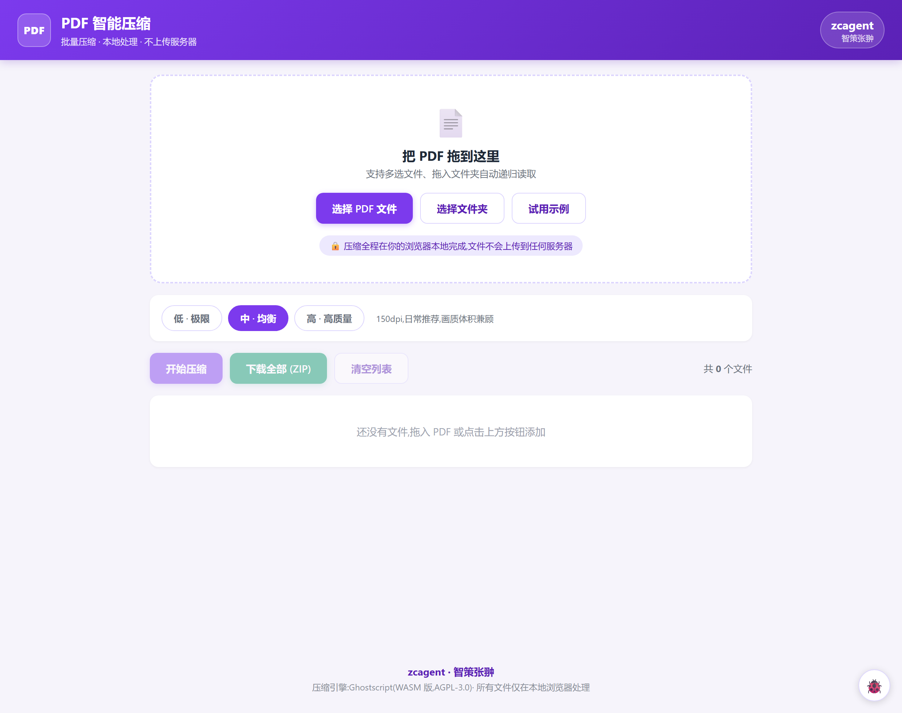
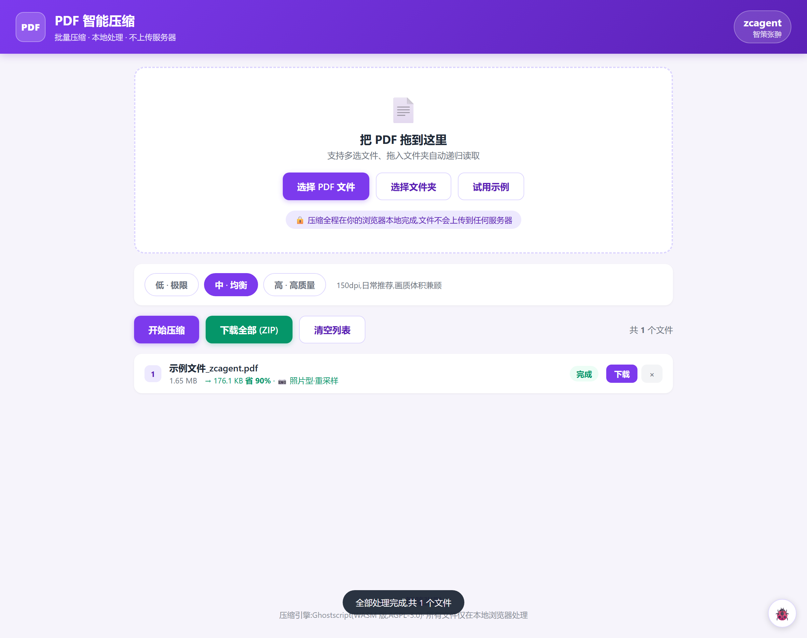

# PDF 智能压缩 · zcagent(智策张翀)

纯浏览器端 PDF 批量压缩工具。**文件全程不上传服务器**，压缩、批量和 ZIP 打包全部在你的浏览器里完成。

### 🔗 在线使用

**https://pdf-compress-zcagent.app.workbuddy.host/?sharecode=254ATZAYX2**

> 加 `&debug=1` 打开调试模式，右下角 🐞 按钮可查看完整处理日志。

## 截图

**首页**



**压缩完成**（示例文件 1.65 MB → 176 KB，省 90%）



## 功能

| 功能 | 说明 |
|---|---|
| 多选文件 | 一次选多个 PDF |
| 选文件夹 | 自动递归读取文件夹下所有 PDF，ZIP 内保留目录结构 |
| 拖拽 | 支持拖文件、拖整个文件夹 |
| 三档压缩 | 低（极限）/ 中（均衡）/ 高（高质量） |
| **显示压缩后大小** | 每行显示 `1.65 MB → 176.1 KB 省 90%` |
| 单文件下载 | 每个文件行有「下载」按钮 |
| ZIP 打包 | 「下载全部 (ZIP)」一次打包所有结果 |
| 无大小限制 | 几 MB 到几十 MB 都照压（单线程 wasm，耗时随页数线性增长） |
| 隐私 | 文件只在本机浏览器内存中处理，不发生任何上传 |

## 双管线路由（自动识别）

```
PDF 进来
  ├─ pdf.js 探测：每页平均文本 < 200 字？
  │
  ├─ 是（照片型：手机拍照扫描件）
  │   → pdf.js 渲染 → OffscreenCanvas 重采样 → JPEG 重建 → pdf-lib 组装
  │   → 低 100dpi/q48/0.80 · 中 150dpi/q55/0.90 · 高 200dpi/q72/1.00
  │
  └─ 否（文字型：课件/文档/表格）
      → Ghostscript-WASM pdfwrite 强制重编码（PassThroughJPEGImages=false）
      → 保留文本层，可搜索、可复制（17MB wasm 按需加载）
```

**为什么分两条管线**：实测 Ghostscript 10.08 WASM 的 `DownsampleColorImages` / `JPEGQ` 参数全部失效（试过 6 种写法，输出恒定），只有强制重编码有效（约 30%）。照片型需要可控的分辨率+质量控制，所以走渲染重采样；文字型必须保留文本层，只能走 Ghostscript。

## 实测数据

**高分辨率拍照件**（2400×3400 每页，A4 页面）

| 档位 | 原始 | 压缩后 | 压缩率 |
|---|---|---|---|
| 中 · 均衡（默认） | 1.65 MB | 176 KB | **90%** |

**手机扫描 App 产物**（4.92 MB / 7 页 / 2328×3264pt，图像有效 72dpi，质量约 90）

| 档位 | 压缩后 | 压缩率 | 耗时 |
|---|---|---|---|
| 低 · 极限 | 2.15 MB | **56%** | 1.0s |
| 中 · 均衡 | 2.64 MB | **46%** | 1.4s |
| 高 · 高质量 | 4.05 MB | **18%** | 1.9s |

> 这类文件的分辨率已到底（72dpi），压缩空间只在 JPEG 质量维度，所以压缩率低于高分辨率件属正常。

**文字型 PDF**（10 页纯文字，3362 字/页）：11.4 KB → 8.0 KB（30%），文本层完整保留。

## 目录结构

```
index.html              主页面
css/style.css           紫色主题样式（含调试面板、手机竖屏适配）
js/app.js               主逻辑：文件收集 / UI 渲染 / 调度 / ZIP 打包 / 示例生成
js/compress.worker.js   压缩 worker（ESM）：类型探测 + 双管线
vendor/pdfjs/           pdf.js 6.4.299（渲染 + 文本探测）
vendor/pdf-lib/         pdf-lib 1.17.1（PDF 重建 / 示例生成）
vendor/jszip/           JSZip 3.10.2（ZIP 打包）
vendor/wghostscript/    Ghostscript 10.08 WASM（文字型重编码，AGPL-3.0）
screenshots/            界面截图
```

## 部署（静态托管 + CDN 缓存）

本项目是纯静态站点，任意静态托管都能部署。

> ⚠️ **改完代码必须同时改版本号**，否则 CDN 缓存会让线上继续跑旧文件（本项目在 EdgeOne 上踩过）：
> 1. `js/app.js` 里的 `var ASSET_VER = 'xxxxx';`
> 2. `index.html` 里的 `css/style.css?v=xxxxx` 和 `js/app.js?v=xxxxx`
>
> worker 的 URL 由 app.js 自动拼 `?v=ASSET_VER`。

本地预览：

```bash
python -m http.server 8080 --bind 127.0.0.1
# 打开 http://127.0.0.1:8080/
```

## 踩坑记录

| 坑 | 表现 | 解法 |
|---|---|---|
| Ghostscript 10.08 wasm 的 downsample/JPEGQ 失效 | 各参数输出恒等，无压缩 | 照片型改走渲染重采样，gs 只做文字型强制重编码 |
| worker 里静态 import 失败是静默的 | 只报「Worker 异常：未知」 | 依赖全改动态 `import()`，可 try/catch 上报 |
| pdf.js 6.x 的 `PDFDocumentProxy` 没有 `destroy()` | `doc.destroy is not a function` | 用 `doc.cleanup()` |
| `doc.getPage(i)` 返回 Promise | `.getTextContent is not a function`，文本量恒 0，**所有 PDF 被误判照片型** | 先 `await doc.getPage(i)` |
| 档位键不一致 | app 传 `screen/ebook/printer`，worker 用 `low/mid/high`，永远走 mid | 统一传 `state.preset` |
| CDN 缓存 | 部署成功但线上跑旧代码 | 资源加 `?v=` 版本号 |
| 分享链接校验 | 子资源不带 sharecode 返回 403 登录页 | worker URL 拼 `location.search` |
| `hidden` 属性被 `display:flex` 覆盖 | 调试面板一直显示 | `.debug-panel[hidden] { display: none !important; }` |

## 调试

线上加 `?debug=1`，页面右下角 🐞 打开日志面板。日志直接渲染在 DOM 里（可复制），包含：

- 依赖加载耗时（pdf.js / pdf-lib / Ghostscript）
- 文件类型探测结果（页数、页 1 尺寸、平均文本字数、路由判定）
- 每页渲染尺寸与输出 JPEG 大小、耗时
- 压缩率与错误堆栈

## 许可

本项目代码采用 MIT 许可。`vendor/wghostscript/` 来自 [Ghostscript](https://www.ghostscript.com/)（AGPL-3.0），`vendor/pdfjs/` 来自 [pdf.js](https://github.com/mozilla/pdf.js)（Apache-2.0），`vendor/pdf-lib/` 为 MIT，`vendor/jszip/` 为 MIT/GPLv3 双许可。二次分发请遵守各自许可。

---

zcagent · 智策张翀
